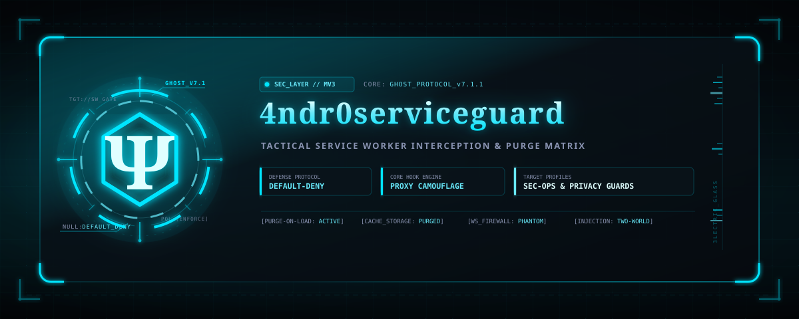

<p align="center">
  
</p>

[](https://github.com/4ndr0666/4ndr0serviceguard)
[](LICENSE)

**A dual-purpose Chrome Extension:**

- For **everyday users**: proactively disable Service Workers to improve browser performance, reduce tracking, and gain predictability.
- For **Red Team operators and penetration testers**: a tactical tool to neutralize client-side Service Worker defenses and expose hidden application logic.

---

## The Problem

Service Workers enable offline caching, push notifications, background sync, and request interception. While powerful, they introduce several issues:

- **Stale Content**: Aggressive caching can hide fresh data.
- **Unwanted Notifications & Background Activity**: Persistent prompts and silent network requests.
- **Performance & Battery Overhead**: Additional CPU and resource consumption.
- **Privacy Erosion**: Background execution without clear user visibility.
- **Security Obfuscation**: Client-side validation, request manipulation, and hidden API surface.
- **Persistence**: blocking *new* registrations is not enough — previously registered workers keep running and keep their caches (see the [reference technique](https://www.bugbugnow.net/2020/03/Reject-to-register-a-ServiceWorker.html)).

For power users, developers, and security professionals, having control over this layer is critical.

---

## The Solution: The Ghost Protocol

`4ndr0serviceguard` enforces a **default-deny Service Worker policy**. All registration attempts are intercepted and nullified unless the domain is explicitly whitelisted — and pre-existing registrations (plus their CacheStorage) are purged on load. A **blacklist** complements the whitelist: blacklisted domains are denied absolutely — before the master toggle, before the whitelist, even in pass-through mode. Since **v7.3.0** a **spooflist** joins them: spooflisted domains are silently pacified — every socket opens, behaves, and never transmits — with no prompt, ever.

The **Ghost Protocol** (`ghost_core_v7.js`) is a stealthy, Proxy-based interception system that replaces `navigator.serviceWorker` with a controlled interface. It returns dynamically generated, convincing fake `ServiceWorkerRegistration` objects when blocking, so `toString()` checks, property identity, and instance checks all stay native-looking.

- Everyday users gain faster, cleaner, and more private browsing.
- Red Team operators can surgically dismantle Service Worker protections, reveal hidden endpoints, bypass client-side controls, and force legacy application paths.

---

## Features

### Core Features
- 🛡️ **Ghost Protocol v7.3**: Stealthy Proxy-based Service Worker nullification (`toString()`-transparent hooks)
- 🧹 **Purge-on-Load**: unregisters pre-existing Service Workers and clears CacheStorage on protected origins
- ✍️ **Enforced Whitelist**: domain + automatic subdomain support — whitelisted origins get real Service Workers, no prompts
- ⛔ **Absolute Blacklist**: explicit-prohibition list — hard-denied before the master toggle, the spooflist, the whitelist and the DDoS-Guard fast path; survives pass-through mode; mutually exclusive with the other lists on single-domain adds
- 👻 **Silent Spooflist**: auto-spoof list — sites you want spoofed by default never prompt; every socket is pacified (stays "open", swallows sends, honors close)
- ⚡ **Three-Way Action Model**: every decision is AUTHORIZE (real) / SPOOF (pacify) / DENY (native-faithful failure) — at the gate, in the prompt, in the Quick Bar, in the popup and in the userscript
- 🎯 **In-Page Quick Bar**: the default decision surface — a 3lectric-Glass bar in the page (no focus-stealing OS window): one click or one key (A/S/D, Enter, Esc), remembered-scope selector (connection / site / endpoint), 30 s auto-deny countdown; the prompt window remains available as fallback and explicit preference
- 🖥️ **Current-Site Quick Actions**: the toolbar popup's CURRENT SITE panel settles authorize/spoof/block/ask-again for the active site in one click, with live policy badges
- 🤫 **Dynamic API Mocking**: identity-stable fake objects minimize breakage and detection
- ⚡ **Instant Execution**: injected at `document_start` in the MAIN world (plus an ISOLATED-world bootstrap bridge)
- ✅ **Live Validation & Approval UI**: 3lectric-Glass popup with real-time blocked-attempt monitoring
- 🔄 **One-Click Decisions**: allow, spoof or permanently block individual attempts or whole origins from the popup, the Quick Bar and the Gatekeeper prompt
- 🎚️ **Functional Master Toggle**: default-deny ↔ pass-through, reflected in the toolbar icon
- 🌉 **Userscript Policy Bridge**: the helper userscript's menu/HUD site rules route to the extension's CONFIRM bar on governed pages — one policy store, no more split-brain blacklists
- ✨ **Manifest V3**: modern, asynchronous architecture with restart-safe state

### Operator Enhancements (v6–v7.2)
- **Dual-Layer Hooking**: both `navigator.serviceWorker` and `ServiceWorkerContainer.prototype.register`
- **CSP Resilience**: prototype-level hooking + `securitypolicyviolation` listener
- **Live Blocked Attempts**: real-time visibility into intercepted Service Worker, WebSocket and SharedWorker attempts
- **WebSocket Firewall**: full phantom WebSocket with DDoS-Guard fast-path exemption and live property forwarding
- **Blacklist Enforcement**: gate order rate-limit → blacklist → toggle → DDoS-Guard → whitelist → prompt; the Gatekeeper prompt can settle a denial AND blacklist the domain in one click
- **Tri-Mode Integration**: one-click piping of the current page + blocked data into the tri-mode editor (URL hash + clipboard payload)
- **Violentmonkey Companion**: Service-Worker-focused userscript version (`ghost_core_v7.user.js`)
- **Completed Helper Userscript**: full standalone Ghost Protocol for userscript managers (`userscript/4ndr0tools - 4ndr0serviceguarder.user.js`) — blacklist + whitelist, master toggle, purge-on-load, stealth Proxy hooks, glass status HUD with the Ψ glyph, and automatic deferral to the extension's Gatekeeper when the extension is present

See [MITIGATION_LOG.md](MITIGATION_LOG.md) for the full v7.0 → v7.1 → v7.1.1 → v7.2.0 → v7.3.0 gap-closure record (v7.3.0: quick-decision surface, spooflist, three-way action model, policy bridge, matching fixes).

---

## How It Works

### Two-World Injection (v7.1)
MAIN-world scripts cannot use `chrome.*` APIs, so the extension runs two content scripts at `document_start`:

1. `ghost_bridge.js` (**ISOLATED** world) — publishes the extension ID into the DOM.
2. `ghost_core_v7.js` (**MAIN** world) — installs all hooks synchronously, then reaches the background through the `externally_connectable` messaging stub (`chrome.runtime.sendMessage(extensionId, …)`).

### Ghost Core (`ghost_core_v7.js`)
- Replaces `navigator.serviceWorker` with a memoized, identity-stable phantom container.
- Intercepts `register()` through Proxies over the native functions — stealth-faithful `toString()`, `name`, and `length`.
- Returns rich fake registrations by default; real registrations only after authorization.
- **Purges pre-existing registrations and clears CacheStorage** on protected origins (bugbugnow.net technique).
- Includes a secondary prototype-level hook for increased CSP resistance.
- Listens for CSP violations related to workers.

### WebSocket Handling
- Full phantom WebSocket implementation (buffered sends, live event/property forwarding) with DDoS-Guard fast-path exemption.
- Gatekept via the same permission system.

### Background Controller (`background.js`)
- Unified router: internal extension contexts (`onMessage` — popup, prompt window, ghost_bridge Quick Bar) + the Ghost Core (`onMessageExternal`, action-restricted and rate-limited).
- Enforcement order per gate request: rate limit → **blacklist hard-deny** → **spooflist auto-spoof** → master toggle → DDoS-Guard → whitelist → interactive decision (Quick Bar first, prompt window fallback).
- Every gate response carries an ACTION (`allow` / `spoof` / `deny`) alongside the v7.2 `allowed` boolean — fully backward compatible.
- Decision lifecycle is fully managed (query-stripped dedup, per-tab caps, close-to-deny, restart-safe request IDs, ack-based surface fallback, cross-surface dismissal); the Quick Bar and the prompt can both settle AND record a remembered site rule.
- Maintains whitelist, spooflist and blacklist in `chrome.storage.sync` (mutually exclusive on single adds); telemetry in `chrome.storage.local` with serialized writes.
- Domain normalization accepts bare domains, URLs with schemes/paths/ports, and boundary-dot noise — pasted URLs finally match.

### Popup UI
- 3lectric-Glass paradigm (4NDR0666OS UI/UX spec): Matrix Deep Base glass levels, Electric Cyan accents, JetBrains Mono / Orbitron typography, 150ms transitions, rectangular brutalist buttons, destructive-action (#ff0055) surfaces, 0-radius cyan scrollbars, and the Ψ branding glyph.
- **CURRENT SITE panel**: live origin + policy badges (AUTHORIZED / SPOOFED / BLOCKED / ASKING) and one-click AUTHORIZE / SPOOF / BLOCK / ASK AGAIN.
- Master Ghost Protocol toggle (icon follows state); decision-surface preference (inline Quick Bar vs prompt window).
- Live blocked attempts list with per-item ALLOW, SPOOF and BLOCK buttons.
- Whitelist, spooflist and blacklist management (one domain per line each).
- Direct "Send to tri-mode" integration.

---

## Red Team Operational Scenarios

### 1. Bypassing Client-Side Validation
Disable Service Workers on targets that use them for request signing, token injection, or payload encryption. Raw traffic becomes visible to interception proxies.

### 2. De-cloaking Hidden Endpoints
Many modern applications route all API calls through a Service Worker. Nullifying it often forces the application to fall back to direct requests, exposing real backend infrastructure.

### 3. Forcing Legacy Fallback Paths
Complex PWAs frequently contain older, less hardened code paths that only activate when Service Workers are absent. This can surface legacy vulnerabilities.

---

## Installation

Not available on the Chrome Web Store. Load unpacked:

```bash
git clone https://github.com/4ndr0666/4ndr0serviceguard.git
```

1. Navigate to `chrome://extensions`
2. Enable **Developer mode**
3. Click **Load unpacked** and select the project folder

Requires Chrome 111+ (`"world": "MAIN"` support).

---

## Usage

1. Click the extension icon to open the control popup.
2. Toggle **Ghost Protocol** (default: enabled = default-deny). The toolbar icon follows the state.
3. Use the **CURRENT SITE** panel for one-click site rules: AUTHORIZE (whitelist), SPOOF (spooflist — never asks, silent pacifier), BLOCK (blacklist — absolute prohibition) or ASK AGAIN (remove all rules for the site).
4. Or manage the lists as text (one per line): the whitelist grants real connections; the spooflist auto-spoofs silently; the blacklist hard-denies absolutely — even with the Ghost Protocol toggled off. Pasted URLs are normalized (scheme/path/port stripped) automatically.
5. Reload target tabs after making changes.
6. When a page attempts a Service Worker / WebSocket / SharedWorker connection that no list covers, the decision surface appears — by default the **in-page Quick Bar**: AUTHORIZE (A) / SPOOF (S) / DENY (D), a remembered-scope selector (this connection / this site / this endpoint), Enter = authorize, Esc = deny, and a 30 s auto-deny countdown. Prefer OS windows? Switch the decision surface to **PROMPT WINDOW** in the popup — the same three actions plus ALWAYS-variants, site-scoped.
7. The popup's live list offers per-attempt ALLOW / SPOOF / BLOCK buttons plus whole-origin approval.

**Which action when?** AUTHORIZE for endpoints you trust and need (live data, working push). SPOOF for sites that merely *want* a socket — the page sees a healthy open connection, nothing is ever transmitted, no retries, no nagging, no fallbacks to noisier channels. DENY for a native-faithful handshake failure (sites that must *react* to a dead socket).

For quick personal use, the Violentmonkey companion script (`ghost_core_v7.user.js`) is also available — it enforces Service-Worker blocking with purge + cache clearing and uses `@exclude` lines as its whitelist.

The completed helper userscript (`userscript/4ndr0tools - 4ndr0serviceguarder.user.js`) is the full standalone Ghost Protocol for Tampermonkey/Violentmonkey: same default-deny doctrine and three-way action model with local whitelist + spooflist + blacklist + master toggle, purge-on-load, stealth Proxy hooks, pacified and denied WS phantoms, a 3lectric-Glass status HUD (menu command: **Show status HUD (Ψ)**), and bounded deny notifications (off by default, stealth doctrine). When the extension is present on a page, the helper stands down to utility mode so the extension's Gatekeeper runs exactly once — no double gating, in either injection order — **and its menu/HUD site rules route to the extension's CONFIRM bar** (the policy bridge), so blacklisting or spoof-listing a site from the userscript menu actually reaches the extension's lists.

---

## Tactical Notes

- The extension applies default-deny immediately upon injection.
- Use the whitelist surgically during engagements; use the spooflist for sites you want quietly pacified ("spoof by default" — zero prompts, zero breakage); use the blacklist for hosts that must never open workers or sockets (trackers, telemetry sinks, hostile CDNs).
- The blacklist and spooflist are absolute: they precede the master toggle, the DDoS-Guard fast path and the whitelist, and survive pass-through mode. Single-domain adds keep the three lists mutually exclusive; after independent bulk edits the gate resolves in order — blacklist beats spooflist beats whitelist.
- The Quick Bar settles over the internal channel in a closed shadow root with `isTrusted`-gated handlers — the page cannot press AUTHORIZE for itself, and page-spammed policy requests are capped, throttled and auto-ignored.
- The popup shows live blocked attempts for rapid decision-making.
- The tri-mode integration pipes the current page and blocked-attempt data through the URL hash and the clipboard.
- The `externally_connectable` surface is restricted to three actions (`ghostStatus`, `requestPermission`, `swAttemptLog`), rate-limited per tab; page scripts cannot forge an allow, a spoof grant, a prohibition or a settlement — every decision still requires your consent or an explicit list entry.

---

## Mechanism of Action (v7.1)

- **Dual-Layer Interception**: `navigator.serviceWorker` + `ServiceWorkerContainer.prototype.register`
- **Proxy Camouflage**: all hooks are Proxies over native functions — `toString()`, `name`, `length` stay native
- **Dynamic Mocking**: identity-stable fake registrations with functional event targets
- **Purge-on-Load**: pre-existing registrations unregistered, CacheStorage cleared
- **CSP Awareness**: prototype hook + violation event listener
- **Surgical Restoration**: whitelisted origins pass through to the real API
- **Event Emission**: real-time telemetry of blocked and allowed attempts

---

## Customization

No build step required. Edit `ghost_core_v7.js`, `popup.js`, or `background.js` directly and reload the extension.

---

## Version History (Relevant)

- **v7.3.0** — Quick-decision cycle (field report: "blacklisting does not stop the persistent popup on sites I want to spoof by default"): three-way action model (AUTHORIZE / SPOOF / DENY), silent spooflist, in-page Quick Bar (keyboard + countdown + remembered scopes) with the prompt window as fallback, site-scoped remember grants (the endpoint-host grant-scope defect), robust domain normalization (pasted URLs match), query-stripped dedup, popup CURRENT SITE panel + per-attempt SPOOF, decision-surface preference, and the userscript↔extension policy bridge (split-brain fix) (see [MITIGATION_LOG.md](MITIGATION_LOG.md))
- **v7.2.0** — Blacklist enforcement (absolute-prohibition gate step, mutual-exclusion list management, prompt/popup blacklist controls), completed helper userscript (stealth dual-layer hooks, WS phantom, SharedWorker gate, purge, local lists, 3lectric-Glass HUD, extension deferral), 3lectric-Glass spec alignment across popup/prompt, constructor-fidelity hardening, unified 7.2.0 version bump across every component (see [MITIGATION_LOG.md](MITIGATION_LOG.md))
- **v7.1.0** — Gap-mitigation release: purge-on-load + cache clearing, enforced whitelist, functional master toggle, working popup/background IPC, restart-safe telemetry, Proxy camouflage, live WebSocket property forwarding, userscript companion, LICENSE, 50-item gap closure (see [MITIGATION_LOG.md](MITIGATION_LOG.md))
- **v7.0.0** — Prototype-level hooking and CSP violation handling
- **v6.0.0** — Major UI overhaul (Electric-Glassmorphism), live blocked attempts, tri-mode integration
- Earlier versions used the older "pacifier" naming and Nullifier Protocol

---

## Contributing

Pull requests and issues are welcome. Focus areas include further CSP hardening, additional API coverage, and UI/UX improvements.

---

## License

Licensed under the MIT License. See [LICENSE](LICENSE).
